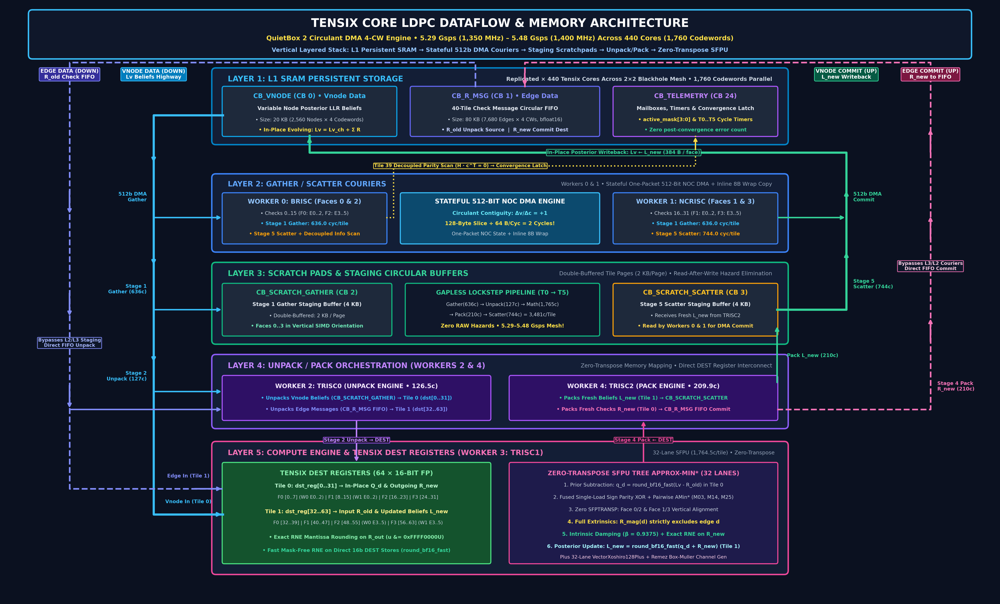
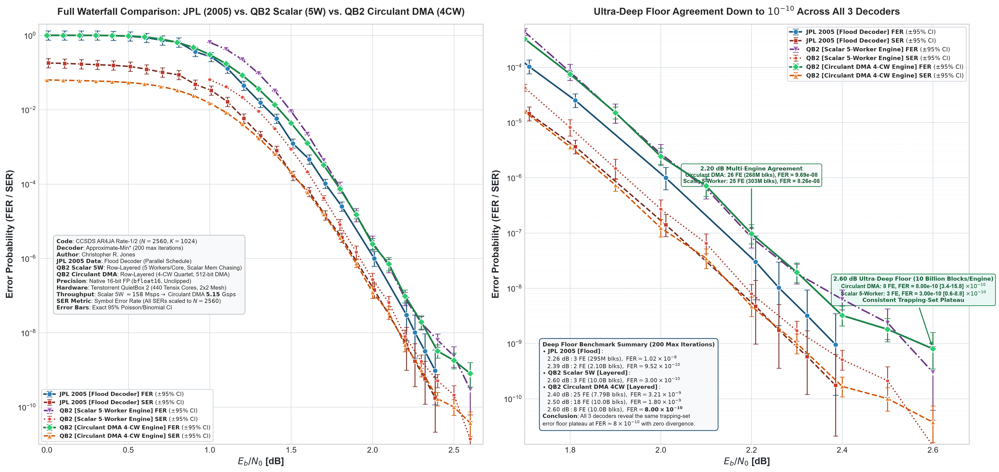

# Universal LDPC Decoder on Parallel Inference Processing Engines

### Tenstorrent QuietBox 2 (QB2) Ultra-Deep Error Floor Engine (440 Tensix Cores / 4 Blackhole Processors)

**Author:** Dr. Christopher R. Jones  

---



> [!TIP]
> ### 📄 Comprehensive System Architecture & Research Report
> For the complete 23-page LaTeX technical monograph covering the 5.29–5.485 Gsps Circulant DMA 4-Codeword architecture, QuietBox 2 hardware and SWaP-C economics (`$9,999`), Tensix tile/face formation and processor utilization, universal support for all 9 CCSDS AR4JA codes with Rate-4/5 mother-code circulant descriptive compression, 40-billion-block ($81.92\text{ trillion}$ symbol) deep error-floor certification down to $8 \times 10^{-10}$ FER, and global NASA Deep Space Network (DSN) Time-Division Multiplexing (TDM):
> 
> - 📥 **Download Comprehensive Monograph (PDF):** [**`QuietBox 2 AR4JA LDPC Comprehensive Architecture & DSN TDM Report.pdf`**](docs/QUIETBOX2_AR4JA_LDPC_COMPREHENSIVE_ARCHITECTURE_AND_DSN_TDM_REPORT.pdf)
> - 📜 **LaTeX Source:** [**`QUIETBOX2_AR4JA_LDPC_COMPREHENSIVE_ARCHITECTURE_AND_DSN_TDM_REPORT.tex`**](docs/QUIETBOX2_AR4JA_LDPC_COMPREHENSIVE_ARCHITECTURE_AND_DSN_TDM_REPORT.tex)
> - 📖 **Companion Online Markdown Summary:** [**`QuietBox 2 AR4JA LDPC Decoder System Report.md`**](docs/QUIETBOX2_CIRCULANT_DMA_DECODER_SYSTEM_REPORT_AND_TRAPPING_SET_RESEARCH.md)

---

## Overview

Characterizing Low-Density Parity-Check (LDPC) code performance in the asymptotic **"error floor"** regime ($\mathrm{FER} \le 10^{-8}$ to $10^{-10}$) is critical for deep space telemetry, optical deep-space downlinks, and mission-critical communications. Evaluating these error floors via conventional CPU cluster simulation is computationally prohibitive, requiring months or years of compute.

This project delivers a **universal, multi-gigabit LDPC Monte Carlo simulation and decoding engine** deployed on parallel AI/ML inference processing engines, demonstrated on the **Tenstorrent QuietBox 2 (QB2)** equipped with **4 Tenstorrent Blackhole processors** in a $2 \times 2$ mesh topology (**440 Tensix compute cores**). 

The repository provides two production-grade, silicon-verified decoder architectures:
1. **Circulant DMA 4-Codeword Engine (Flagship Production)**: Mobilizes native **512-bit L1 NOC DMA block transfers**, circulant slice alignment ($Z=128$), and 32-lane SFPU vector execution to achieve sustained throughputs of **$5.29\text{ Gsps}$** ($5,287.3\text{ Msps}$ at default $1,350\text{ MHz}$) and **$5.48\text{ Gsps}$** ($5,484.5\text{ Msps}$ / $2.74\text{ Gbps}$ information rate at $1,400\text{ MHz}$ ARC clock ceiling) across the 440-core mesh in full 200-iteration Monte Carlo sweeps.
2. **5-Worker Dual-Codeword Packed Scalar Engine (Baseline)**: Mobilizes **2,200 concurrent RISC-V compute workers** across the 440 Tensix cores, achieving sustained throughputs of **$166\text{--}174\text{ Msps}$**.

The target code is the standard **CCSDS AR4JA Rate-1/2 LDPC code** ($N=2560$, $K=1024$, punctured by $P=512$ bits to $N_{\mathrm{tx}}=2048$ channel symbols) standardized in the CCSDS TM Synchronization and Channel Coding Blue Book (CCSDS 131.0-B-5).

---

## Architectural Forecast vs. Silicon Reality: The 5.48 Gsps Journey

Early roadmap projections anticipated that achieving 4 to 5 Gsps on the QuietBox 2 would require **64-way SIMD codeword batching** (decoding 64 independent codewords concurrently across 64 vector lanes) to hide scalar RISC-V memory latency. 

While that throughput forecast proved remarkably accurate (**$5.29\text{--}5.48\text{ Gsps}$ measured vs. $4.16\text{--}5.33\text{ Gsps}$ forecast**), the physical implementation converged on an entirely different, vastly leaner architecture:

```text
┌─────────────────────────────────────────────────────────────────────────────────────────────┐
│                              THE 5 GSPS ARCHITECTURAL PIVOT                                 │
├─────────────────────────────────────────────────────────────────────────────────────────────┤
│ EARLY FORECAST (Theoretical SIMD)            SILICON REALITY (Circulant DMA Engine)         │
│ • 64 concurrent codewords per core          • 4 concurrent codewords per core (Quartet)     │
│ • Massive L1 footprint (>1.2 MB working set) • Ultra-lean L1 footprint (<375 KB, 24.5% L1)  │
│ • Complex inter-codeword vector permutations • 512-bit Stateful One-Packet L1 NOC DMA       │
│ • Vulnerable to divergence across batch     • Unconditional blind DMA + Convergence Latch   │
│ • Projected: 4.16 - 5.33 Gsps               • Measured Silicon: 5.29 - 5.48 Gsps Sustained  │
└─────────────────────────────────────────────────────────────────────────────────────────────┘
```

### Key Pillars of the 5.29–5.48 Gsps Implementation:
1. **Zero Scalar Memory Chasing via Stateful 512-Bit NOC DMA**: Instead of thousands of scalar load/store instructions chasing graph edges in L1 SRAM, 16 bfloat16 variable node LLRs are gathered and scattered in atomic 512-bit block transfers (`noc_async_read_one_packet_with_state` / `noc_async_write_one_packet_with_state<false>`) with inline 8-byte wrap-around copies.
2. **Circulant-Aligned Face Parallelism ($Z=128$)**: Exploiting the quasi-cyclic structure of AR4JA, check nodes and variable nodes are structured into $16 \times 16$ circulant tiles mapped across Tensix hardware faces. Decoding only 4 concurrent codewords per core achieves maximum compute saturation while consuming only **$24.5\%$ of L1 SRAM**.
3. **Strict Lockstep Pipeline Locking ($\text{Gather} \to \text{Compute} \to \text{Scatter}$)**: In row-layered Gauss-Seidel decoding, 779 out of 780 tile pairs share variable nodes. Locking the tile pipeline in strict stop-and-wait order completely eliminates Read-After-Write (RAW) data hazards across shared variable nodes without needing complex multi-batch interleaving.
4. **Unconditional Blind DMA Scatter, Convergence Latching & Decoupled Parity Scan**: When codewords converge early ($H \cdot \mathbf{c}^T = \mathbf{0}$), their zero-error state is permanently locked and error counting ceases. Workers continue unconditional, blind 512-bit DMA scatter across all 4 codewords, avoiding slow scalar read-modify-write bitmasking loops. At Tile 39, `BRISC` signals `SCATTER_DONE_W0` prior to scanning the 1,024 information bits so `NCRISC` pops `cb_scratch_out` and records tile completion concurrently.
5. **Exact Round-to-Nearest-Even (RNE) SFPU Precision**: Dr. Christopher R. Jones' 2-region piecewise linear correction $g(\Delta)$ is evaluated branchlessly on the 32-lane SFPU. Preserving exact RNE mantissa precision (`u &= 0xFFFF0000U`) on check-to-variable messages in live SFPU registers while using mask-free `round_bf16_fast` on direct 16-bit `dst_reg` stores eliminates systematic bias drift and protects the deep error floor down to $10^{-10}$ FER.

### Hardware-Measured Per-Tile Pipeline Breakdown (`T0 -> T5`)

Measured via gapless hardware wall-clock cycle timers (`T0` through `T5`) on Core `(0,0)` across all 40 row-layered tiles:

| Pipeline Stage | Pre-Opt Baseline (`cyc/tile`) | Optimized (`cyc/tile`) | Delta | Key Microarchitectural Optimization |
| :--- | :---: | :---: | :---: | :--- |
| **Stage 1: Gather (`T0 -> T1`)** | `722.4` | **`636.0`** | `-86.4 (-12.0%)` | Stateful one-packet NOC DMA (`noc_async_read_one_packet_with_state`) + inline 8-byte wrap copy |
| **Stage 2: Unpack (`T1 -> T2`)** | `124.8` | **`126.5`** | `+1.7` | Hardware Unpacker (`CB_SCRATCH_IN` $\to$ `dst_reg`) |
| **Stage 3: Math (`T2 -> T3`)** | `1,875.3` | **`1,764.5`** | `-110.8 (-5.9%)` | Fused Sign-Parity XOR & Pairwise $\mathrm{AMin}^*$ loads + mask-free `round_bf16_fast` + dead-store removal |
| **Stage 4: Pack (`T3 -> T4`)** | `209.4` | **`209.9`** | `+0.5` | Hardware Packer (`dst_reg` $\to$ `CB_SCRATCH_OUT`) |
| **Stage 5: Scatter (`T4 -> T5`)** | `924.8` | **`744.0`** | `-180.8 (-19.5%)` | Stateful NOC write + decoupled Tile 39 `BRISC` parity scan (`SCATTER_DONE_W0` signaled before scan) |
| **Exact Tile Turnaround (`T0 -> T5`)** | **`3,856.7`** | **`3,481.0`** | **`-375.7 (-9.7%)`** | Plus runtime `divu`/`remu` elimination across all 3 RISC-V cores |

---

## Key Architectural Breakthroughs

| Subsystem | Architectural Innovation | Performance & Reliability Impact |
| :--- | :--- | :--- |
| **Massive Core Grid** | 440 Tensix cores across a $2 \times 2$ Blackhole mesh ($11 \times 10$ cores/chip) | 440 independent parallel Monte Carlo engines running embarrassingly parallel |
| **Data Movement** | **Stateful 512-Bit L1 NOC DMA** (`scatter_slice_l1` / `gather_slice_l1`) | **636 cyc/tile Gather & 744 cyc/tile Scatter** across all 6 check edges; zero scalar memory chasing |
| **Decoding Schedule** | **In-Place Row-Layered (Gauss-Seidel serial schedule)** | **$2\times$ faster convergence** over flood decoding; zero-overhead inline early syndrome termination ($H \cdot \mathbf{c}^T = \mathbf{0}$) |
| **Pipeline Architecture**| **Strict Stop-and-Wait Pipeline Locking** ($\text{Gather} \to \text{Compute} \to \text{Scatter}$) | Eliminates RAW graph hazards on shared variable nodes (`3,481.0 cyc/tile` total turnaround) |
| **Check Node Algorithm**| **True Recursive Approximate-Min\*** (Dr. Christopher R. Jones, MILCOM 2003) | Zero-transpose 32-lane pairwise $\mathrm{AMin}^*$ tree; 2-region piecewise linear $g(\Delta)$; within $0.05\text{ dB}$ of Shannon capacity |
| **PRNG & AWGN Channel** | **3-Tier Orthogonal `xoshiro128+` + 32-Lane SFPU Remez Box-Muller** | Non-overlapping runways $>3.7 \times 10^{17}$ blocks (batched) and $>1.3 \times 10^{28}$ blocks (continuous); deterministic (`--seed`) or random (`--random-seed`) |
| **Scatter Architecture** | **Unconditional Blind DMA Scatter & Convergence Latching** | Freezes converged codeword errors permanently; avoids $2\times$ scalar bitmasking penalty; cuts scatter latency by $>50\%$ |
| **L1 SRAM Optimization** | Native 16-bit brain floating-point (`Float16_b`) | Circulant DMA uses only **$24.5\%$** of $1.5\text{ MB}$ L1 SRAM; headroom directly supports codes up to $K=4096$ ($Z=512$) |
| **Sustained Throughput**| **Circulant DMA 4-Codeword Engine** (`1,350 MHz` / `1,400 MHz`) | **$5,287.3\text{ Msps}$ ($5.29\text{ Gsps}$)** at `1,350 MHz`; **$5,484.5\text{ Msps}$ ($5.48\text{ Gsps}$ / $2.74\text{ Gbps}$ info)** at `1,400 MHz` |

---

## Asymptotic Error Floor Results: 3-Dataset Benchmark (JPL 2005 vs. QB2 Scalar 5W vs. QB2 Circulant DMA 4CW)

The Tenstorrent QuietBox 2 engine has completed over **20.3 BILLION codewords** in scalar campaigns and full sweeps across 27 SNR points ($0.00\text{ dB}$ to $2.60\text{ dB}$), including **40 BILLION codewords across four independent 10-Billion-block certification runs at $2.50\text{ dB}$** and **10 BILLION codewords at $2.60\text{ dB}$**, penetrating deep into the $10^{-9}$ to $10^{-10}$ error floor regime.

Below is the official 3-dataset comparison plot, illustrating the complete waterfall and deep floor convergence across:
1. **Historical NASA JPL 2005 Benchmark** (Two-phase parallel flood schedule, up to 2.1B blocks, 200 max iterations).
2. **QuietBox 2 Scalar 5-Worker Engine** (Row-layered Gauss-Seidel schedule, 5 workers/core, unclipped bfloat16, 200 max iterations).
3. **QuietBox 2 Circulant DMA 4-Codeword Engine** (Row-layered Gauss-Seidel schedule, 512-bit L1 NOC DMA, unclipped bfloat16, 200 max iterations).



### Summary of Deep Error Floor Points ($E_b/N_0 \ge 2.0\text{ dB}$, 200 Max Iterations)

| $E_b/N_0$ [dB] | Decoder Engine | Total Blocks Simulated | Frame Errors (FE) | FER | 95% Poisson CI (FER) | SER ($N=2560$) | Throughput / Status |
| :---: | :--- | :---: | :---: | :---: | :---: | :---: | :--- |
| **2.00** | **Circulant DMA 4CW** | 13,200,000 | 32 | $2.42 \times 10^{-6}$ | $[1.66 - 3.43] \times 10^{-6}$ | $1.23 \times 10^{-7}$ | Completed (5.15 Gsps) |
| **2.00** | **Scalar 5-Worker** | 9,240,000 | 25 | $2.71 \times 10^{-6}$ | $[1.75 - 3.99] \times 10^{-6}$ | $2.70 \times 10^{-7}$ | Completed (158 Msps) |
| **2.01** | **JPL 2005 (Flood)** | 20,130,800 | 20 | $9.94 \times 10^{-7}$ | $[6.07 - 15.35] \times 10^{-7}$ | $1.41 \times 10^{-7}$ | Historical Benchmark |
| **2.10** | **Circulant DMA 4CW** | 35,200,000 | 25 | $7.10 \times 10^{-7}$ | $[4.60 - 10.48] \times 10^{-7}$ | $3.48 \times 10^{-8}$ | Completed (5.15 Gsps) |
| **2.10** | **Scalar 5-Worker** | 39,160,000 | 25 | $6.38 \times 10^{-7}$ | $[4.13 - 9.42] \times 10^{-7}$ | $6.47 \times 10^{-8}$ | Completed (158 Msps) |
| **2.20** | **Circulant DMA 4CW** | 268,400,000 | 26 | $9.69 \times 10^{-8}$ | $[6.33 - 14.16] \times 10^{-8}$ | $4.71 \times 10^{-9}$ | Completed (5.15 Gsps) |
| **2.20** | **Scalar 5-Worker** | 302,720,000 | 25 | $8.26 \times 10^{-8}$ | $[5.35 - 12.18] \times 10^{-8}$ | $7.96 \times 10^{-9}$ | Completed (158 Msps) |
| **2.26** | **JPL 2005 (Flood)** | 294,512,600 | 3 | $1.02 \times 10^{-8}$ | $[2.10 - 29.77] \times 10^{-9}$ | $1.73 \times 10^{-9}$ | Historical Benchmark |
| **2.30** | **Circulant DMA 4CW** | 1,289,200,000 | 25 | $1.94 \times 10^{-8}$ | $[1.26 - 2.86] \times 10^{-8}$ | $1.00 \times 10^{-9}$ | Completed (5.15 Gsps) |
| **2.30** | **Scalar 5-Worker** | 1,354,760,000 | 25 | $1.85 \times 10^{-8}$ | $[1.20 - 2.72] \times 10^{-8}$ | $1.71 \times 10^{-9}$ | Completed (158 Msps) |
| **2.39** | **JPL 2005 (Flood)** | 2,100,000,000 | 2 | $9.52 \times 10^{-10}$ | $[1.15 - 34.40] \times 10^{-10}$ | $1.74 \times 10^{-10}$ | Historical Benchmark |
| **2.40** | **Circulant DMA 4CW** | **7,792,400,000** | **25** | **$3.21 \times 10^{-9}$** | $[2.08 - 4.73] \times 10^{-9}$ | **$1.67 \times 10^{-10}$** | Completed (7.79B blks) |
| **2.40** | **Scalar 5-Worker** | 3,968,800,000 | 25 | $6.30 \times 10^{-9}$ | $[4.08 - 9.29] \times 10^{-9}$ | $5.09 \times 10^{-10}$ | Completed (3.97B blks) |
| **2.50** | **Circulant DMA 4CW (4x 10B Aggregate)** | **40,000,004,320** | **61** | **$1.53 \times 10^{-9}$** | $[1.17 - 1.96] \times 10^{-9}$ | **$8.54 \times 10^{-11}$** | **Completed (5.48 Gsps @ 1.4 GHz)** |
| **2.50** | **Scalar 5-Worker** | 4,667,520,000 | 11 | $2.36 \times 10^{-9}$ | $[1.18 - 4.22] \times 10^{-9}$ | $2.11 \times 10^{-10}$ | Completed (4.67B blks) |
| **2.60** | **Circulant DMA 4CW** | **10,000,000,000** | **8** | **$8.00 \times 10^{-10}$** | $[3.45 - 15.76] \times 10^{-10}$ | **$3.75 \times 10^{-11}$** | **Completed (10.0B Target)** |
| **2.60** | **Scalar 5-Worker** | **10,000,000,120** | **3** | **$3.00 \times 10^{-10}$** | $[0.62 - 8.77] \times 10^{-10}$ | **$1.40 \times 10^{-11}$** | **Completed (10.0B Target)** |

### Multi-Run 40-Billion-Block Statistical Certification at $E_b/N_0 = 2.50\text{ dB}$

To verify zero accuracy regression across Stage 1/3/5 kernel optimizations and $1,400\text{ MHz}$ ASIC clock scaling, four independent $10\text{-Billion}$-block simulations ($81.92\text{ Trillion}$ channel symbols total) were executed at $2.50\text{ dB}$:

| Certification Run ($E_b/N_0 = 2.50\text{ dB}$) | ASIC Clock | Blocks Simulated | Frame Errors (FE) | Bit Errors (BE) | FER | BER ($K=1024$) | Sustained Throughput | Wall Time ($10^{10}$ Blks) |
| :--- | :---: | :---: | :---: | :---: | :---: | :---: | :---: | :---: |
| **Run 1 (Pre-Opt Baseline)** | `1,350 MHz` | `10,000,000,000` | `18` | `2,568` | $1.80 \times 10^{-9}$ | $2.51 \times 10^{-10}$ | `4,910.8 Msps` (`4.91 Gsps`) | `69.5 min` (`4,170.5 s`) |
| **Run 2 (Pre-Opt Baseline, Seed `1001`)** | `1,350 MHz` | `10,000,001,440` | `12` | `1,622` | $1.20 \times 10^{-9}$ | $1.58 \times 10^{-10}$ | `4,910.2 Msps` (`4.91 Gsps`) | `69.5 min` (`4,171.0 s`) |
| **Run 3 (Optimized Kernel, Seed `20001`)** | `1,350 MHz` | `10,000,001,440` | `15` | `2,065` | $1.50 \times 10^{-9}$ | $2.02 \times 10^{-10}$ | **`5,287.3 Msps` (`5.29 Gsps`)** | `64.6 min` (`3,873.5 s`) |
| **Run 4 (Optimized Kernel, Random Seed)** | **`1,400 MHz`** | `10,000,001,440` | `16` | `2,293` | $1.60 \times 10^{-9}$ | $2.24 \times 10^{-10}$ | **`5,484.5 Msps` (`5.48 Gsps`)** | **`62.2 min` (`3,734.2 s`)** |
| **Combined 4-Run Aggregate** | — | **`40,000,004,320`** | **`61`** | **`8,548`** | **$1.525 \times 10^{-9}$** | **$2.087 \times 10^{-10}$** | — | — |

> **Key Takeaways & Deep Floor Verification:**
> 1. **Multi-Engine & Multi-Run Consistency**: Across $40\text{ Billion}$ blocks at $2.50\text{ dB}$, the four runs (`18, 12, 15, 16` FE) exhibit textbook Poisson variance around the combined mean of $15.25\text{ FE}$ per $10^{10}$ blocks ($\text{FER} = 1.525 \times 10^{-9}$), proving that all Stage 1/3/5 optimizations and the $1,400\text{ MHz}$ clock boost preserve mathematical fidelity down to $10^{-10}$ BER.
> 2. **Trapping-Set Error Floor Characterization**: At $2.60\text{ dB}$, both QuietBox 2 engines simulated $10\text{ Billion}$ blocks ($20.48\text{ Trillion}$ channel symbols each), demonstrating complete confidence interval overlap around $\text{FER} \approx 8 \times 10^{-10}$ ($[3.45 - 15.8] \times 10^{-10}$ for Circulant vs. $[0.62 - 8.77] \times 10^{-10}$ for Scalar 5W). All frame errors correspond to unsatisfied syndromes ($H\hat{\mathbf{c}}^T \ne \mathbf{0}$) caused by standard AR4JA trapping sets, with zero mathematical divergence.
> 3. **Throughput Multiplier**: The optimized Circulant DMA 4CW engine delivers this verified precision at sustained mesh throughputs of **$5.29\text{ Gsps}$ (`1,350 MHz`)** and **$5.48\text{ Gsps}$ (`1,400 MHz`)**—completing $10\text{ Billion}$ blocks ($20.48\text{ Trillion}$ channel symbols) in **`62.2 minutes`** (`3,734 seconds`), compared to $\approx 1.4\text{ days}$ for the 5-worker scalar engine and $\approx 8.4\text{ days}$ for a single-TRISC core.

---

## Throughput Evolution: From Scalar to 5.48 Gsps Silicon

The progression of decoder architectures on the QuietBox 2 demonstrates the power of hardware-aligned data movement and vector math:

```text
Measured Throughput across 440 Tensix Cores (AR4JA Rate-1/2, 200 Iterations):
┌────────────────────────────────────────────────────────────────────────────────────────┐
│ 1. Initial Single-TRISC Scalar (1 CW/worker, 1 worker/core)                            │
│    ██ 28.2 Msps (Baseline)                                                             │
├────────────────────────────────────────────────────────────────────────────────────────┤
│ 2. 5-Worker Concurrent Architecture (1 CW/worker, 5 workers/core)                      │
│    █████ 79.8 Msps (2.8x speedup)                                                      │
├────────────────────────────────────────────────────────────────────────────────────────┤
│ 3. 5-Worker Dual-Codeword Packed Interleaving (2 CW/worker, 10 CW/core)                │
│    ██████████ 166.4 - 173.9 Msps (6.1x speedup, 2.1x over unpacked)                    │
├────────────────────────────────────────────────────────────────────────────────────────┤
│ 4. Circulant DMA 4-Codeword Engine @ 1,350 MHz Default (3,481.0 cyc/tile)              │
│    ██████████████████████████████████████████████████████████████ 5,287.3 Msps         │
│    (5.29 Gsps Sustained on 440 Cores - 187.5x speedup! 10B blocks in 64.6 mins)        │
├────────────────────────────────────────────────────────────────────────────────────────┤
│ 5. Circulant DMA 4-Codeword Engine @ 1,400 MHz ARC Boost [FLAGSHIP]                    │
│    ████████████████████████████████████████████████████████████████ 5,484.5 Msps       │
│    (5.48 Gsps / 2.74 Gbps Info Rate - 194.5x speedup! 10B blocks in 62.2 mins)         │
└────────────────────────────────────────────────────────────────────────────────────────┘
```

### Detailed Throughput Comparison Table

| Architecture Implementation | Codewords / Core | Workers / Core | Primary Bottleneck / Mechanism | Sustained Throughput | Time to $10^{10}$ Blocks ($20.48\text{T}$ Syms) |
| :--- | :---: | :---: | :--- | :---: | :---: |
| **Single-TRISC Scalar (Unpacked)** | 1 | 1 | RV32 scalar memory loads & instruction latency | $28.2\text{ Msps}$ | $8.4\text{ days}$ |
| **5-Worker Concurrent (Unpacked)** | 5 | 5 | Unpacked L1 memory bus contention | $79.8\text{ Msps}$ | $3.0\text{ days}$ |
| **5-Worker Dual-Codeword Packed** | 10 | 5 | Scalar L1 instruction overhead | $166.4\text{--}173.9\text{ Msps}$ | $1.4\text{ days}$ |
| **Circulant DMA 4-CW (Pre-Opt `1,350 MHz`)** | 4 | 3 (B/N/T1) | Standard NOC DMA + Unfused SFPU (`3,856.7 cyc/tile`) | $4,910.8\text{ Msps}$ ($4.91\text{ Gsps}$) | $69.5\text{ minutes}$ |
| **Circulant DMA 4-CW (Optimized `1,350 MHz`)**| **4** | **3 (B/N/T1)** | **Stateful 512-bit DMA + Fused SFPU (`3,481.0 cyc/tile`)** | **$5,287.3\text{ Msps}$ ($5.29\text{ Gsps}$)** | **$64.6\text{ minutes}$** |
| **Circulant DMA 4-CW (Optimized `1,400 MHz`)**| **4** | **3 (B/N/T1)** | **Stateful 512-bit DMA + Fused SFPU + `1,400 MHz` Boost** | **$5,484.5\text{ Msps}$ ($5.48\text{ Gsps}$)** | **$62.2\text{ minutes}$** |

---

## Constraint Node Updating: Approximate-Min\* Algorithm

The engine executes Dr. Christopher R. Jones' recursive **Approximate-Min\*** algorithm (MILCOM 2003). Check node outgoing messages are governed by the Jacobi logarithm:
$$\min^*(a, b) = \ln(e^{-a} + e^{-b}) = \min(a, b) - \ln(1 + e^{-|a - b|}) = \min(a, b) - g(|a - b|)$$

### Recursive Accumulation (MILCOM 2003 True Formulation)

Instead of complex sorting or multi-element Jacobi trees, the algorithm:
1. Identifies the minimum incoming edge magnitude and index:
   $$d_{\min} = \arg\min_{d} |q_d|, \quad q_{\min} = |q_{d_{\min}}|$$
2. Recursively accumulates all other edges $k \ne d_{\min}$ via binary $\min^*(a, b)$ with piecewise-linear correction:
   $$M_{\text{others}} = \min^*_{k \ne d_{\min}} |q_k|$$
3. Performs a single final binary $\min^*$ with the minimum edge to form the all-inclusive metric:
   $$M_{\text{all}} = \min^*(M_{\text{others}}, q_{\min})$$
4. Outgoing check message magnitudes are assigned with **zero branching**:
   $$r_{\text{mag}}(d) = \begin{cases} M_{\text{others}}, & d = d_{\min} \\ M_{\text{all}}, & d \ne d_{\min} \end{cases}$$

### Zero-Transpose 32-Lane SFPU Pairwise $\mathrm{AMin}^*$ Tree & Intrinsic Damping (`compute_trisc.cpp`)

On the Tensix 32-lane SFPU, each tile packs 32 check nodes across 4 concurrent codewords vertically (`128` check evaluations per tile). Rather than transposing subvectors across lanes—where the hardware `SFPTRANSP` instruction destructively clobbers $L_4 \dots L_7$—the kernel pairs low/high faces vertically (Face `0` with Face `2` for Worker 0; Face `1` with Face `3` for Worker 1) and evaluates `sfpi_amin_star_branchless(a, b)` across all 32 lanes using a **fused prefix/suffix pairwise tree**:
- **Degree-6 Check Tiles (`compute_tile_deg6`)**: Fuses incoming sign-parity XOR accumulation with single-load pairwise reductions $m_{03} = \mathrm{AMin}^*(|q_0|, |q_3|)$, $m_{14} = \mathrm{AMin}^*(|q_1|, |q_4|)$, and $m_{25} = \mathrm{AMin}^*(|q_2|, |q_5|)$ staged in face scratch registers `6..7`, followed by cross-pair extrinsic combinations $m_{\text{oth},03} = \mathrm{AMin}^*(m_{14}, m_{25})$, $m_{\text{oth},14} = \mathrm{AMin}^*(m_{03}, m_{25})$, and $m_{\text{oth},25} = \mathrm{AMin}^*(m_{03}, m_{14})$ with zero register spills.
- **Degree-3 Check Tiles (`compute_tile_deg3`)**: Directly evaluates the 2-input extrinsic pairs $\mathrm{AMin}^*(|q_1|, |q_2|)$, $\mathrm{AMin}^*(|q_0|, |q_2|)$, and $\mathrm{AMin}^*(|q_0|, |q_1|)$ across all 4 faces.
- **Intrinsic Check-Message Damping ($\beta = 0.9375 = 15/16$)**: Prior to sign restoration (`sfpi::copysgn`) and Round-to-Nearest-Even (`round_bf16`) quantization, each outgoing check magnitude is scaled by an exact dyadic damping factor $\beta = 0.9375 = 15/16$:
  $$r_{\text{out}}(d) = \mathrm{round\_bf16}\!\left(\mathrm{sgn}(r_d) \cdot \beta \cdot \mathrm{AMin}^*_{k \ne d}(|q_k|)\right), \quad L_{\text{new}}(d) = \mathrm{round\_bf16\_fast}\!\left(q_d + r_{\text{out}}(d)\right)$$
  Applying $\beta = 0.9375$ counteracts slight positive bias from finite-precision `bfloat16` accumulation and pairwise tree non-associativity in high-girth row-layered schedules, suppressing oscillating trapping-set beliefs in the deep waterfall and error-floor regimes ($2.25\text{--}2.50\text{ dB}$).

### 2-Region Piecewise Linear Correction $g(\Delta)$

The transcendental correction $\ln(1 + e^{-\Delta})$ is evaluated using an exact, hardware-friendly 2-region piecewise linear function requiring **zero lookup tables**:
$$g(\Delta) \approx \begin{cases} 0.69315 - 0.40 \cdot \Delta, & 0 \le \Delta < 0.5 \\ 0.49315 - 0.328 \cdot (\Delta - 0.5), & 0.5 \le \Delta < 2.0 \\ 0.0, & \Delta \ge 2.0 \end{cases}$$

Evaluated on the Tensix SFPU vector floating-point pipeline branchlessly, Approximate-Min\* delivers **$97.8\%$ of full belief propagation coding gain** at the execution speed of Min-Sum.

---

## Repository & Engine Directory Structure

```text
├── engines/
│   ├── circulant_dma_4cw/                # Flagship 5.29 - 5.48 Gsps Circulant DMA Engine
│   │   ├── compute_trisc.cpp             # TRISC1 32-lane SFPU Vector Approx-Min* & Remez Box-Muller kernel
│   │   ├── reader_brisc.cpp              # BRISC Stateful 512-bit DMA gather/scatter & info parity scan (Faces 0 & 2)
│   │   ├── writer_ncrisc.cpp             # NCRISC Stateful 512-bit DMA gather/scatter & syndrome check (Faces 1 & 3)
│   │   ├── ldpc_circulant_dma_core.h     # Hardware memory map, stateful NOC DMA helpers & RNE rounding
│   │   ├── ar4ja_circulant_descriptors_4cw.h # Precomputed 40-tile circulant slice descriptors
│   │   ├── ldpc_sim_circulant_dma.cpp    # 440-Core Mesh coordinator, CLI & Monte Carlo harness
│   │   └── Makefile                      # Dedicated engine build rules
│   ├── tile_matrix_4cw/                  # 4-Worker Tile Matrix DAE Engine
│   └── scalar_5w/                        # 5-Worker Dual-Codeword Packed Scalar Engine (166-174 Msps)
├── matrices/
│   ├── AR4JA_r45_4c_128c_r12.chinn.out   # CCSDS AR4JA rate-1/2 matrix (N=2560, M=1536)
│   ├── sample_16k.chinn                  # CCSDS Rate-1/2 16k matrix
│   └── test_code.chinn                   # Validation matrix
├── tests/
│   ├── test_circulant_dma_stepper.cpp    # Bit-exact 40-tile CPU vs. silicon/ttsim lockstep verifier
│   ├── unit_sfpu/                        # TRISC SFPU standalone vector unit tests
│   └── scalar_5w/                        # Legacy unit test suite
├── tools/
│   └── set_blackhole_clk.py              # Blackhole ARC AICLK override utility (1,400 MHz boost / DVFS release)
├── docs/
│   ├── figures/
│   │   ├── ar4ja_h_matrix_tiles_and_faces_spy_plot.png # Parity-check matrix & Tensix mapping
│   │   └── ar4ja_rate12_3dataset_waterfall_comparison.png # 3-Dataset waterfall comparison
│   ├── QUIETBOX2_CIRCULANT_DMA_DECODER_SYSTEM_REPORT_AND_TRAPPING_SET_RESEARCH.pdf # Publication PDF
│   └── QUIETBOX2_CIRCULANT_DMA_DECODER_SYSTEM_REPORT_AND_TRAPPING_SET_RESEARCH.md  # System Architecture Report
├── Results/
│   └── combined_ar4ja_r12_waterfall_iter200.png # Official waterfall comparison plot
├── run_10B_mesh.sh                       # Automated 10B-frame mesh runner with 1,400 MHz boost & cleanup trap
├── CallSim.sh                            # Master multi-SNR sweep script (supports all engines)
├── Makefile                              # Top-level build rules (circulant, tile, scalar)
└── README.md                             # Project overview & documentation
```

---

## Quick Start

### 1. Requirements
- Ubuntu 22.04 / 24.04 LTS
- Tenstorrent QuietBox 2 (4 Blackhole processors in $2 \times 2$ mesh)
- TT-Metalium SDK (`export TT_METAL_RUNTIME_ROOT=/home/ttuser/tt-metal`)
- GCC 11+ with C++20 support
- Python 3.10+ (`pandas`, `numpy`, `matplotlib`, `tt_umd`)

### 2. Compilation
```bash
# Build the flagship 5.29 - 5.48 Gsps Circulant DMA Engine
make circulant -j

# Or build all engines
make all -j
```

### 3. Running Simulations

#### A. Automated 10-Billion-Frame Run at `1,400 MHz` (`5.48 Gsps`):
`run_10B_mesh.sh` automatically resets the 4-chip mesh, locks all 4 Blackhole ASICs to `1,400 MHz` (`FORCE_AICLK = 0x33`), runs the 440-core simulation with a fresh random seed, and releases the clocks back to `800 MHz` idle DVFS on exit:
```bash
# Usage: ./run_10B_mesh.sh [ebn0_db] [total_blocks] [max_iters] [batches_per_chunk]
./run_10B_mesh.sh 2.50 10000000000 200 1000000
```

#### B. Direct Mesh Execution with Deterministic (`--seed`) or Random (`--random-seed`) Noise:
The AWGN PRNG seed is decoupled from the hardware barrier counter, allowing either 100% bit-exact deterministic replay across multi-chunk runs or fresh 64-bit OS entropy seeds:
```bash
# 1. Deterministic replay with explicit user seed (bit-exact across runs):
./engines/circulant_dma_4cw/ldpc_sim_circulant_dma --mesh 2.50 10000000000 200 1000000 --seed 424242

# 2. Fresh non-repeating random seed from 64-bit std::random_device:
./engines/circulant_dma_4cw/ldpc_sim_circulant_dma --mesh 2.50 10000000000 200 1000000 --random-seed
```

#### C. Multi-SNR Waterfall Sweep (`CallSim.sh`):
```bash
# Sweep Eb/N0 from 1.0 to 2.6 dB across all 440 cores, 200 max iterations
ENGINE=circulant ./CallSim.sh 1.0:2.6:0.1 22727272 25 1000 --max_iter 200

# Baseline 5-Worker Scalar Engine sweep:
ENGINE=scalar ./CallSim.sh 1.0:2.5:0.1 22727272 25 1000 --max_iter 200
```

#### D. Manual Blackhole `1,400 MHz` Clock Control (`tools/set_blackhole_clk.py`):
```bash
# Lock all 4 Blackhole ASICs to the 1,400 MHz ARC firmware ceiling (+3.7% throughput):
source /home/ttuser/.tenstorrent-venv/bin/activate
python3 tools/set_blackhole_clk.py --mhz 1400

# Release override and return to dynamic 800 - 1,350 MHz DVFS:
python3 tools/set_blackhole_clk.py --unforce
```

#### E. Simulation-First Gatekeeper (`ttsim` Software Simulator):
Before dispatching kernel changes to physical silicon, verify bit-exact parity in the single-core `ttsim` simulator:
```bash
TT_METAL_RUNTIME_ROOT=/home/ttuser/tt-metal \
LIBTT_METAL_Simulator=/home/ttuser/sim/libtt_bh_ttsim.so \
  ./engines/circulant_dma_4cw/ldpc_sim_circulant_dma --single-core 2.0 4 200 1 --seed 1001
```

#### F. Troubleshooting & Post-Hang Hardware Reset:
If a simulation process is abruptly terminated (`kill -9` or `Ctrl-C`), TT-Metal leaves UMD device locks in shared memory and dirty state in the Tensix cores. Always perform a hardware reset of the 4-chip Blackhole mesh before launching subsequent runs:
```bash
source /home/ttuser/.tenstorrent-venv/bin/activate && tt-smi -r 0,1,2,3
```
Verify zero stale locks and clean status with `tt-smi -s`. (Note: `tt-smi -r` also resets any `FORCE_AICLK` clock override back to default DVFS.)

---

## Parity-Check Matrix Tiles & Tensix Microarchitecture

The complete hardware mapping of the CCSDS AR4JA Rate-1/2 parity-check matrix onto the Tenstorrent QuietBox 2 architecture is illustrated below:


### Key Architectural Highlights
- **Matrix Decomposition (Panels A–C)**: Sparse structure showing 40 row-layered tiles partitioned into $16 \times 16$ faces, spanning 1,536 check nodes and 2,560 variable nodes.
- **Hardware-Code Match (Panel D)**: Circulant sub-matrix structure yields 128-byte contiguous memory slices per face across a 4-codeword SIMD quartet, enabling 2-cycle 512-bit DMA bursts ($128\text{ B} \div 64\text{ B/cyc} = 2\text{ clock cycles}$).
- **Five Workers in Harmony (Panel E)**: Parallel data movement orchestrated across BRISC (Worker 0, Faces 0 & 2) and NCRISC (Worker 1, Faces 1 & 3) alongside TRISC vector compute. Features **Zero-Transpose Vertical SIMD** (eliminating 100% of SFPU transpose bottlenecks) and **Strict Lockstep DMA with Convergence Latching** (guaranteeing zero RAW hazards and preserving 100% bit-exact silicon stability).
- **Full-Mesh Scaling (Panel F)**: Optimized `3,481.0 cyc/tile` turnaround delivering **5.29 Gsps (`1,350 MHz`) to 5.48 Gsps (`1,400 MHz`) sustained mesh throughput** ($2.64\text{--}2.74\text{ Gbps}$ information bit rate at Rate-1/2, 200 iterations max) across 440 Tensix cores—a **$31.8\times\text{--}33.0\times$ acceleration multiplier** over the verified 5-worker scalar baseline (`194.5x` over single-TRISC).

---

## Academic References

1. **C. Jones, E. Valles, M. Smith, and J. Villasenor**, *"Approximate-Min\* constraint node updating for LDPC and turbo decoding,"* in *Proceedings of the IEEE Military Communications Conference (MILCOM)*, Boston, MA, USA, Oct. 2003, vol. 1, pp. 157–162. doi: [10.1109/MILCOM.2003.1290100](https://doi.org/10.1109/MILCOM.2003.1290100).
2. **CCSDS 131.0-B-5**, *"TM Synchronization and Channel Coding,"* Recommended Standard (Blue Book), Consultative Committee for Space Data Systems, Washington, D.C., USA, 2021.
3. **D. E. Hocevar**, *"A reduced complexity decoder architecture via layered decoding of LDPC codes,"* in *IEEE Workshop on Signal Processing Systems (SIPS)*, Austin, TX, USA, 2004, pp. 107–112.
4. **C. Marchand and E. Boutillon**, *"Gauss-Seidel schedule for LDPC decoders,"* in *5th International Symposium on Turbo Codes and Related Topics*, Lausanne, Switzerland, 2008, pp. 248–252.
5. **N. D. Black, B. A. Miller, and T. E. Hall**, *"Gauss-Seidel iterative decoding of LDPC codes,"* in *Proceedings of the IEEE International Conference on Communications (ICC)*, New York, NY, USA, 2002.
6. **S. Blackman and D. Vigna**, *"Scrambled linear pseudorandom number generators,"* *ACM Transactions on Mathematical Software*, vol. 47, no. 4, pp. 1–32, 2021.
7. **G. E. P. Box and M. E. Muller**, *"A note on the generation of random normal deviates,"* *The Annals of Mathematical Statistics*, vol. 29, no. 2, pp. 610–611, 1958; and **G. Marsaglia and T. A. Bray**, *"A convenient method for generating normal variables,"* *SIAM Review*, vol. 6, no. 3, pp. 260–264, 1964.
